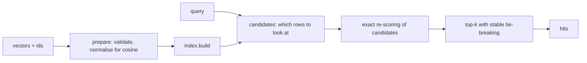

# vecsearch

An approximate nearest-neighbour search library written from scratch on top of NumPy, with a
benchmark harness that measures what approximate search is actually about: how much recall you
give up for how much speed. I built it to understand what vector databases do under the hood
instead of treating them as a black box.

## What is in it

| index | idea | main knobs |
| --- | --- | --- |
| `flat` | exact brute force, used as ground truth | none |
| `ivf` | k-means partitions the data, a query scans only its `nprobe` closest cells | `nlist`, `nprobe` |
| `lsh` | random-hyperplane hashing in several tables with one-bit multi-probe | `n_tables`, `n_bits` |

Supported metrics are Euclidean (`l2`) and `cosine`. A FastAPI service exposes the indexes over
HTTP, and indexes can be saved to and loaded from disk without pickle.

## Architecture



Every index only decides **which rows are worth scoring**. Exact distances and top-k selection live
in one shared base class. That keeps each algorithm short, makes them directly comparable, and lets
the benchmark report the fraction of the dataset each query actually touched.

## Setup

```bash
uv sync
uv run pytest
```

## Benchmark

```bash
uv run python -m vecsearch.cli --n 20000 --dim 64 --queries 200 --k 10
```

The output has one row per configuration with recall against exact search, the share of the data
scanned per query, throughput and latency percentiles. One run on my laptop (20,000 clustered
vectors, 64 dimensions, 100 queries, k=10):

```text
index               recall  scanned       qps   p50 ms   p95 ms  build s
flat                 1.000   100.0%       111    8.501   11.996    0.003
ivf nprobe=1         0.781     1.8%      4843    0.201    0.309    1.378
ivf nprobe=2         0.945     3.4%      2148    0.436    0.778    1.541
ivf nprobe=4         1.000     5.9%      1031    0.873    2.299    1.202
lsh tables=4         1.000     9.2%       534    1.742    3.646    0.046
lsh tables=16        1.000     22.0%       250    3.798    6.171    0.198
```

Treat these as an illustration, not a benchmark claim: timings depend on the machine, and the
data is synthetic and well clustered, which is the easy case for both IVF and LSH. The pattern is
the point. Recall rises with `nprobe` or the number of LSH tables, and so does the share of data
scanned.

## Usage

```python
import numpy as np
from vecsearch.core import Metric
from vecsearch.index.registry import create_index

rng = np.random.default_rng(0)
vectors = rng.normal(size=(10_000, 64))
index = create_index("ivf", Metric.COSINE, nlist=64, nprobe=4)
index.build([f"doc-{i}" for i in range(len(vectors))], vectors)

for hit in index.search(vectors[42], k=5):
    print(hit.id, round(hit.distance, 4))
```

HTTP service:

```bash
uv run uvicorn vecsearch.api:app --reload
curl -X PUT localhost:8000/indexes/demo -H 'content-type: application/json' \
  -d '{"algorithm": "flat", "ids": ["a", "b"], "vectors": [[0, 0], [1, 1]]}'
curl -X POST localhost:8000/indexes/demo/search -H 'content-type: application/json' \
  -d '{"vector": [0.9, 0.9], "k": 1}'
```

## Design notes

- **One code path for both metrics.** For cosine, vectors are normalised once on the way in. On
  unit vectors squared Euclidean distance equals `2 * (1 - cosine)`, so every index can work in
  Euclidean space and convert at the end.
- **Deterministic results.** Every random component is seeded, and ties are broken by row index.
  That is what makes saving only vectors and parameters safe: loading rebuilds an identical index.
- **No pickle.** Persistence uses `.npy` plus a JSON manifest, so loading a file cannot execute code.
- **Clustered benchmark data on purpose.** On uniform random vectors in high dimensions every point
  is about equally far from every other, and neither IVF nor LSH can help. Real embeddings are
  clustered, so the generator makes Gaussian blobs.
- **Limitations.** The indexes are static: you rebuild to add data. Everything lives in memory,
  distances use full precision, and there is no graph index such as HNSW or any quantisation. Those
  are the obvious next steps, and the candidate-generator design is meant to make adding them easy.

## Tests

```bash
uv run ruff format --check . && uv run ruff check . && uv run mypy src && uv run pytest
```

## Docker

```bash
docker build -t vecsearch . && docker run -p 8000:8000 vecsearch
```
